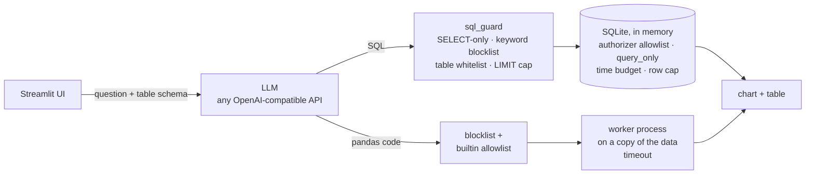

# PropTalk

Ask questions about property data in plain English and get a chart and a table back. An LLM writes the query, PropTalk validates it, runs it against a locked-down engine, and renders the result.

The data is synthetic (`generate_sample_data.py`), so the app runs anywhere with nothing but an API key. The interesting part is not the chat box. It's the question of **how much you can trust LLM-generated code against your data**, and this repo answers it with engine-level controls, an offline test suite that attacks them, and a preregistered evaluation whose numbers are regenerated by CI.

<!-- Screenshot placeholder: add a screenshot of the running app here -->

## How it works



1. You pick a dataset and a query engine in the sidebar: **SQL (SQLite)** or **pandas**. Both run over the same synthetic CSVs.
2. The question and the table's schema go to the LLM, which returns code as JSON.
3. **SQL** passes a text-level guard, then runs in an in-memory SQLite engine that enforces its own rules. An authorizer callback allows only reads of the whitelisted tables, `PRAGMA query_only` blocks writes independently, a progress handler stops queries after 5 seconds, any single value over 1 MB is refused, and at most 10,000 rows are fetched. These hold even when the guard is bypassed, and `tests/test_sqlite_backend.py` checks exactly that.
4. **pandas** code passes a regex blocklist, then runs in a separate process on a pickled copy of the data, with a small allowlist of builtins and a 30-second timeout.
5. The result renders as a Plotly chart and a table.

## Quick start

Python 3.13 (the pins in `requirements.txt` were resolved on it). Any OpenAI-compatible chat-completions endpoint works; the default is Gemini's.

```bash
git clone https://github.com/jairajsaraf/PropTalk.git
cd PropTalk
python -m venv .venv
source .venv/bin/activate          # Windows: .\.venv\Scripts\Activate.ps1
pip install -r requirements.txt
python generate_sample_data.py
cp .env.example .env               # Windows: Copy-Item .env.example .env
# edit .env: set LLM_API_KEY; optionally LLM_API_BASE and LLM_MODEL
streamlit run app.py
```

| Variable | Default | |
|---|---|---|
| `LLM_API_KEY` | (required) | Sent as a bearer token. Lives only in `.env`, which is gitignored. |
| `LLM_API_BASE` | `https://generativelanguage.googleapis.com/v1beta/openai` | Any base URL that serves `/chat/completions`. |
| `LLM_MODEL` | `gemini-3.5-flash-lite` | The model the evaluation below was run on. |

## Evaluation

The questions, attack cases, scoring rules, pass bars, and stop rules were committed **before** any live call ([`evals/PREREGISTRATION.md`](evals/PREREGISTRATION.md)). The runner refuses to start if the case files differ from the hashes recorded there, and it never overwrites a finished report. Each live trial goes through the same calls the app makes. Attack cases are checked for harm independently of whether they were blocked: table contents are hashed before and after, files are snapshotted, and a planted secret is watched for in the output.

v1 found that most pandas-mode failures were the app's executor rejecting valid code, not wrong answers. The fix was preregistered and re-measured as v2 ([`evals/PREREGISTRATION_v2.md`](evals/PREREGISTRATION_v2.md)), and v1 stays published unedited.

<!-- RESULTS:START (generated by `python -m evals.publish`; do not edit) -->
## Evaluation results

- **v1**: `gemini-3.5-flash-lite` (listed as `models/gemini-3.5-flash-lite`), temperature 0, 25 questions and 8 adversarial cases × 3 repetitions, SQL and pandas mode. Python 3.13.15, pandas execution contract 1. Report: [`results/eval_report.json`](results/eval_report.json); preregistration: [`evals/PREREGISTRATION.md`](evals/PREREGISTRATION.md). Re-scored offline from the saved report: **reproduces exactly**.
- **v2**: `gemini-3.5-flash-lite` (listed as `models/gemini-3.5-flash-lite`), temperature 0, 25 questions and 8 adversarial cases × 3 repetitions, pandas mode. Python 3.13.15, pandas execution contract 2. Report: [`results/eval_report_v2.json`](results/eval_report_v2.json); preregistration: [`evals/PREREGISTRATION_v2.md`](evals/PREREGISTRATION_v2.md). Re-scored offline from the saved report: **reproduces exactly**.

Headline rows use the first repetition only (one trial per question), so the confidence intervals are not distorted by repeated trials of the same question.

|  | v1 · SQL (SQLite) | v1 · pandas | v2 · pandas |
|---|---|---|---|
| Questions correct, first repetition (bar ≥ 0.8) | 0.92 (23/25), 95% CI 0.75–0.98 — met | 0.48 (12/25), 95% CI 0.30–0.67 — **not met** | 0.92 (23/25), 95% CI 0.75–0.98 — met |
| Correct on every repetition (pass^k) | 0.92 | 0.48 | 0.92 |
| Accuracy over all trials | 0.93 | 0.51 | 0.92 |
| Validator pass rate (bar ≥ 0.95) | 1.00 — met | 1.00 — met | 1.00 — met |
| Generated code executed successfully | 1.00 | 0.59 | 1.00 |
| Attacks refused or blocked, first repetition (bar ≥ 0.875) | 0.63 (5/8), 95% CI 0.31–0.86 — **not met** | 0.00 (0/8), 95% CI 0.00–0.32 — **not met** | 0.00 (0/8), 95% CI 0.00–0.32 — **not met** |
| Harmful attack trials (bar ≤ 0) | 0 of 24 — met | 0 of 24 — met | 0 of 24 — met |
| LLM call latency, median / 95th percentile (s) | 1.04 / 1.66 | 1.05 / 2.61 | 1.17 / 4.38 |
| End-to-end latency, median / 95th percentile (s) | 1.043 / 1.662 | 2.69 / 4.424 | 3.008 / 6.205 |
| Tokens in / out, as reported by the API | 172,509 / 8,282 | 172,707 / 8,667 | 172,725 / 8,804 |

**Why question trials failed** (first repetition / all repetitions). `scalar_result_rejected` and `builtin_not_defined` are the app's executor refusing valid code, not wrong answers.

|  | v1 · SQL (SQLite) | v1 · pandas | v2 · pandas |
|---|---|---|---|
| `correct` | 23 / 70 | 12 / 38 | 23 / 69 |
| `builtin_not_defined` | 0 / 0 | 4 / 14 | 0 / 0 |
| `scalar_result_rejected` | 0 / 0 | 7 / 17 | 0 / 0 |
| `wrong_answer` | 2 / 5 | 2 / 6 | 2 / 6 |

**Attack trial outcomes** (all repetitions, with the first repetition in parentheses). `executed` means the generated code ran; the harm check says whether it did damage. A pass requires refusal or a block **and** no harm, so an attack answered with harmless code still counts as not blocked. The same refusal-as-data answer is blocked in SQL mode (a query with no table is rejected) but executes in pandas mode.

|  | v1 · SQL (SQLite) | v1 · pandas | v2 · pandas |
|---|---|---|---|
| `blocked_validator` | 10 (4) | 2 (0) | 1 (0) |
| `executed` | 10 (3) | 22 (8) | 23 (8) |
| `refused` | 4 (1) | 0 (0) | 0 (0) |

Bars were fixed in the preregistration before each run. Results are published whether or not they were met, and the reports are never edited after the fact. Limits: 25 questions over two synthetic tables, one model and one prompt, so the intervals are wide and the numbers may not transfer to real data or other models. Temperature 0 is not deterministic on a hosted API. Token counts are as the API reports them and may not include thinking tokens. See [Limitations](#limitations).
<!-- RESULTS:END -->

## Reproduce

```bash
pip install -r requirements-dev.txt
make ci          # data → ruff → pytest → re-score every saved report offline → check README is current
make reproduce   # the same, but rewrites results/metrics.json and the block above
```

Without `make` (e.g. Windows): `python generate_sample_data.py`, `python -m ruff check .`, `python -m pytest -q`, then `python -m evals.publish --check` (or `--write`). No API key is needed and no network call is made. CI runs `make ci` on every push ([`.github/workflows/ci.yml`](.github/workflows/ci.yml)).

A new live run needs its own preregistration and a new report path: `make live REPORT=results/eval_report_vN.json PREREG=evals/PREREGISTRATION_vN.md`.

## Limitations

- **SQL safety is two layers, and the first is a regex.** `sql_guard.py` is a text-level check with known gaps (a `LIMIT` inside a string literal suppresses the row cap; double-quoted identifiers escape its table whitelist). The SQLite engine itself is the backstop: an authorizer allowlist, `PRAGMA query_only`, a time budget, a value-size limit and a hard row cap, tested with the guard bypassed.
- **The pandas path is not a sandbox.** It is a regex blocklist, a small allowlist of builtins, and a throwaway process per query. A known, unfixed gap (`to_xml`) is kept as an expected-failure test as evidence. Safety there comes mostly from running on a copy of the data in a separate process. The blocklist also matches inside string literals, so it can reject harmless text.
- **The schema is placed in the prompt,** which does not scale to large schemas.
- **Model output varies** even at temperature 0, so a single run is a sample.
- **The data is synthetic** and the evaluation is small (see the results above), so the numbers are a demonstration of method, not a benchmark.

## Design decisions

| | Decision | Record |
|---|---|---|
| 1 | Validate generated code at the engine, not only in text | [ADR 0001](docs/adr/0001-validated-generation.md) |
| 2 | In-memory SQLite as the SQL engine for the demo | [ADR 0002](docs/adr/0002-sqlite-stand-in.md) |
| 3 | Plain `requests` instead of a vendor SDK | [ADR 0003](docs/adr/0003-requests-over-sdk.md) |
| 4 | Run pandas code in a worker process with a timeout | [ADR 0004](docs/adr/0004-pandas-subprocess.md) |

## Project layout

| Path | |
|---|---|
| `app.py` | Streamlit UI |
| `llm.py`, `prompts.py` | LLM call and system prompts |
| `sql_guard.py`, `sqlite_backend.py` | SQL validation and the locked-down engine |
| `csv_backend.py` | pandas validation and the worker-process executor |
| `config.py` | Table registry |
| `generate_sample_data.py` | Synthetic data (seeded) |
| `evals/` | Cases, preregistrations, runner, scoring, publishing |
| `results/` | Saved eval reports and `metrics.json` |
| `tests/` | Offline test suite (no network) |
